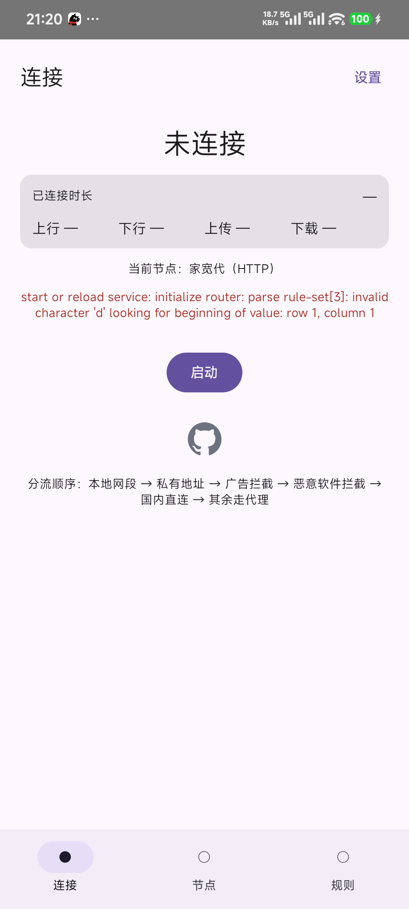
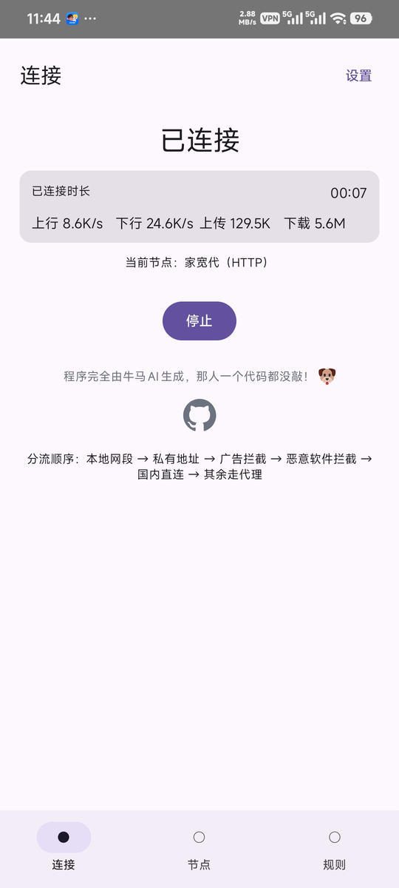

<div align="center">


# 老戴理 · MarvisProxy

**一个极简的 Android 全局代理客户端：VpnService + sing-box 内核，单节点 HTTP / SOCKS5 出站，国内直连、其余走代理。**

[](https://github.com/lookmm/ldl_http-socks5/releases)
[-3ddc84)](https://github.com/lookmm/ldl_http-socks5/releases)
[](LICENSE)

[下载安装](#下载安装) · [功能特性](#功能特性) · [从源码构建](#从源码构建) · [用户手册](USER_GUIDE.md) · [致谢与引用](#致谢与开源引用) · [常见问题](USER_GUIDE.md#常见问题)

**程序完全由牛马AI生成，那人一个代码都没敲！** 

<sub>AI 生成内容标识：本项目代码与文档由 AI 助手辅助生成，经维护者审阅后发布；AI 输出不代表任何第三方立场。</sub>

</div>

---

## 这是什么

把一台自建的家宽 / 云主机上的 HTTP 或 SOCKS5 代理，变成手机上的「一键全局代理」：

- **不用 root、不用写配置**：填地址端口账号密码，点「启动」即可接管全机流量（VpnService + TUN）。
- **国内直连不绕路**：内置 `geosite-cn` / `geoip-cn` 规则集，国内域名与国内 IP 直连，只有境外流量才走你的节点。4G 出门刷国内 App 完全不经中继。
- **配置里没有任何写死的节点**：APK 与源码中不含真实地址、账号、密码，节点全部在界面上填写或扫码导入，可安全公开分发。
- **密码不落明文**：节点密码经 Android Keystore（AES-GCM）加密后落盘。

> 本项目只提供客户端。你需要自己准备好一个可用的 HTTP / SOCKS5 代理服务端。

## 下载安装

前往 [Releases](https://github.com/lookmm/ldl_http-socks5/releases/latest) 下载最新 `MarvisProxy-x.y.z-debug.apk`，手机侧载安装（需允许"安装未知来源应用"）。

- 系统要求：Android 7.0 (API 24) 及以上，`arm64-v8a`
- 仅 28MB 左右，无后台常驻服务、无广告 SDK、无统计上报
- 装好后照着 [用户手册](USER_GUIDE.md) 三步配好节点即可

App 内置更新检查：启动后自动比对仓库 `version.json`，有新版本直接在应用内下载安装。

## 界面

<div align="center">




</div>

首页一屏到底：状态、连接时长、实时上下行 / 累计流量、当前节点、分流顺序与两个开关。

## 功能特性

| 模块 | 能力 |
| --- | --- |
| 代理内核 | sing-box（libbox）本地运行，TUN 入站接管全机流量，单一 HTTP / SOCKS5 出站 |
| 协议 | HTTP、HTTPS（TLS 包装）、SOCKS5（可选用户名密码） |
| 分流 | 本地网段 → 私有地址 → 广告拦截 → 恶意软件拦截 → 国内直连（geosite-cn / geoip-cn）→ 其余走代理 |
| DNS | 国内域名走本地 UDP DNS，境外域名走 DoH（detour 代理），避免污染 |
| 忽略列表 | 自定义直连网段（CIDR）与直连域名，默认含通用私有地址段 |
| 广告拦截 | 内置 `geosite-category-ads-all` 规则集，命中直接拒绝 |
| 恶意拦截 | 支持在线更新恶意 / 钓鱼域名清单，命中直接拒绝 |
| 规则集更新 | 一键更新 4 项（geosite / geoip / ads / malware），多镜像按序回退，支持取消；可自定义更新源 |
| 更新通道 | 自动 / 直连 / 代理 三档，直连镜像与节点代理各走各的，互不拖累 |
| 配置迁移 | 导出 `LYVPN1:` 文本串或二维码，另一台设备扫码 / 粘贴即恢复 |
| 自动化 | 自动连接：App 启动与手机重启后按上次状态自动连（需 VPN 授权仍有效） |
| 更新 | 内置版本检查与 APK 下载安装，5 个元数据镜像 + 3 个附件镜像兜底 |

## 从源码构建

环境：JDK 17、Android SDK（compileSdk 34）、Gradle 8.x。

```bash
git clone https://github.com/lookmm/ldl_http-socks5.git
cd ldl_http-socks5

# 1) 放置 sing-box 内核（上游预编译产物，不入库）
mkdir -p app/libs
# 将 libbox-arm64.aar 放到 app/libs/ 下

# 2) 指向本机 SDK
echo "sdk.dir=/path/to/android-sdk" > local.properties

# 3) 构建
gradle :app:assembleDebug
```

产物：`app/build/outputs/apk/debug/app-debug.apk`（`arm64-v8a`，`minSdk 24`，`targetSdk 34`）。

**关于 `libbox-arm64.aar`**：这是 [sing-box](https://github.com/SagerNet/sing-box) 的 Android 内核库（含 `libbox.so`），属上游二进制依赖而非本项目源码，因此不纳入本仓库。自行编译请取其 `libbox` 构建产物；或使用与本项目同版本的 [Release](https://github.com/lookmm/ldl_http-socks5/releases) APK 对照。

## 目录结构

```
app/src/main/
├── java/com/liuyunli/proxy/
│   ├── MainActivity.kt       # 单页 Compose 界面（首页 / 节点 / 规则 / 设置）
│   ├── ProxyVpnService.kt    # VpnService + sing-box 生命周期、通知栏流量
│   ├── ProxyConfig.kt        # sing-box 配置生成（tun/http/dns/route/rule_set）
│   ├── NodeConfig.kt         # 单节点模型、持久化、脱敏展示
│   ├── SecretStore.kt        # Keystore AES-GCM 密码加密
│   ├── RuleSetUpdater.kt     # 规则集更新（多镜像顺序回退、可取消）
│   ├── ProxyDownloader.kt    # 手写 CONNECT 隧道，走节点代理下载
│   ├── UpdateChecker.kt      # 版本检查、APK 下载与拉起安装（version.json + Release 附件）
│   ├── IgnoreList.kt         # 直连 CIDR / 域名
│   ├── RulePrefs.kt          # 开关、更新通道、自定义源持久化
│   ├── ConfigTransfer.kt     # LYVPN1: 文本串 / 二维码导入导出
│   ├── ScanActivity.kt       # CameraX 扫码导入
│   ├── TrafficMeter.kt       # 实时速率与累计流量
│   ├── BootReceiver.kt       # 开机自启
│   └── Fmt.kt / PlatformImpl.java
├── assets/                   # 打包内置规则集 geosite-cn / geoip-cn / ads
└── res/
```

## 安全与隐私

- 仓库内**不含任何节点地址、账号、密码**；`ProxyConfig` / `NodeConfig` 默认值全为空字符串。
- 密码落盘前经 Android Keystore 加密（`SecretStore`，AES-GCM，密钥不出 TEE）。
- 权限共 6 类：VPN 服务、前台服务（special use）、通知、相机（仅扫码）、网络状态、开机自启；无网络上报、无第三方统计 SDK。
- 导出的 `LYVPN1:` 串与二维码**含明文密码**，仅在本机屏幕与剪贴板流转，请勿外发。
- 日志只打印 `type://host:port` 级短标识，不含凭据。

## 免责声明

本项目仅供个人自建代理的客户端使用，请遵守所在国家 / 地区的法律法规与服务商条款。使用本软件产生的任何后果由使用者自行承担。

## 致谢与开源引用

这个项目站在很多开源工作之上。下面按依赖程度列出所用项目与参考对象，感谢作者与社区的无偿投入：

| 项目 | 本项目中的用途 | 许可证 | 说明 |
| --- | --- | --- | --- |
| [SagerNet/sing-box](https://github.com/SagerNet/sing-box) | 代理内核：`libbox` 在 App 内本地运行，负责 TUN 入站、出站与分流 | GPL-3.0-or-later（附名称使用附加条款） | 运行时二进制依赖，上游 AAR 未随仓库分发 |
| [SagerNet/sing-geosite](https://github.com/SagerNet/sing-geosite) | `geosite-cn`、`geosite-category-ads-all` 规则集来源 | GPL-3.0 | 规则数据，构建期转换为 `.srs` |
| [SagerNet/sing-geoip](https://github.com/SagerNet/sing-geoip) | `geoip-cn` 规则集来源 | GPL-3.0 | 同上 |
| [MetaCubeX/mihomo](https://github.com/MetaCubeX/mihomo) | 分流规则的组织顺序与配置结构参考 | GPL-3.0 | 仅思路参考，未复制代码 |
| [MetaCubeX/ClashMetaForAndroid](https://github.com/MetaCubeX/ClashMetaForAndroid) | 「减法」架构参考：内核与 UI 解耦、单页配置流 | GPL-3.0 | 仅架构与交互参考 |
| [Karing](https://github.com/KaringX/karing) / SFA | 功能形态与交互细节参考 | GPL-3.0 + 附加条款 | 仅功能参考，未复用其代码 |
| [AndroidX / Jetpack Compose / CameraX](https://developer.android.com/jetpack) | UI、状态管理与相机扫码 | Apache-2.0 | 见 `THIRD_PARTY_NOTICES.md` |
| [zxing](https://github.com/zxing/zxing) | 二维码生成与识别 | Apache-2.0 | Android 客户端库 |
| [Twemoji](https://github.com/jdecked/twemoji) | 首页狗头 emoji 图形（`docs/dog-emoji.png`、`res/drawable-xxxhdpi/emoji_dog.png`） | [CC-BY 4.0](https://creativecommons.org/licenses/by/4.0/) | 图形版权归 Twitter/X，按 CC-BY 署名使用 |

第三方组件的完整许可证文本与版权声明见 [`THIRD_PARTY_NOTICES.md`](THIRD_PARTY_NOTICES.md)。

## 许可证合规说明

- **整体许可为 GPL-3.0**。本项目发布的 APK 打包了 sing-box 的 `libbox`（GPL-3.0-or-later）。按 GPL 的传染性要求，分发包含该库的作品时，整个作品必须以 GPL-3.0 兼容条款分发，并向接收者提供完整对应源码。本仓库即该源码（不含任何节点凭据），构建步骤见上文「从源码构建」。自 `v0.5.11` 起，本项目整体以 GPL-3.0 授权；此前发布的历史版本按其发布时的 MIT 条款继续有效。
- **源码提供义务已满足**：`app/` 下为全部自研源码，`LICENSE` 为 GPL-3.0 全文；未做任何混淆或闭源封装。唯一不在仓库内的是上游 `libbox-arm64.aar` 预编译产物，可从 [SagerNet/sing-box Releases](https://github.com/SagerNet/sing-box/releases) 获取同版本构建。
- **版权声明保留**：sing-box 及其规则集版权归原作者（nekohasekai / SagerNet），未做删除或修改；本项目自研部分版权归 lookmm。
- **名称与关联**：sing-box 的附加条款要求「未经事先同意，衍生作品不得使用其名称或暗示关联」。本项目名称为 **老戴理 / MarvisProxy**，与 SagerNet、MetaCubeX 无隶属、赞助或背书关系；文档中提及 sing-box 仅为事实性依赖说明与致谢，不构成对其名称的商标性使用。
- **未纳入附加条款代码**：Karing、SFA 等带「GPL-3.0 + 原名禁用」附加条款的项目仅作功能与交互参考，未复制其源码，因此本项目不构成其衍生作品，不受其附加条款约束。
- **Apache-2.0 组件**：AndroidX、CameraX、zxing 等按其要求保留版权与许可声明，详见 `THIRD_PARTY_NOTICES.md`。
- **规则集数据**：内置 `geosite-cn` / `geoip-cn` / ads 规则集源自 GPL-3.0 仓库，随本项目以 GPL-3.0 一并分发。

## License

[GPL-3.0](LICENSE) © 2026 lookmm

本项目为自由软件：你可以依据自由软件基金会发布的 GNU 通用公共许可证第三版（或更新版本）条款重新分发和/或修改它。本程序按「现状」提供，不附带任何担保。详见 [LICENSE](LICENSE)。
